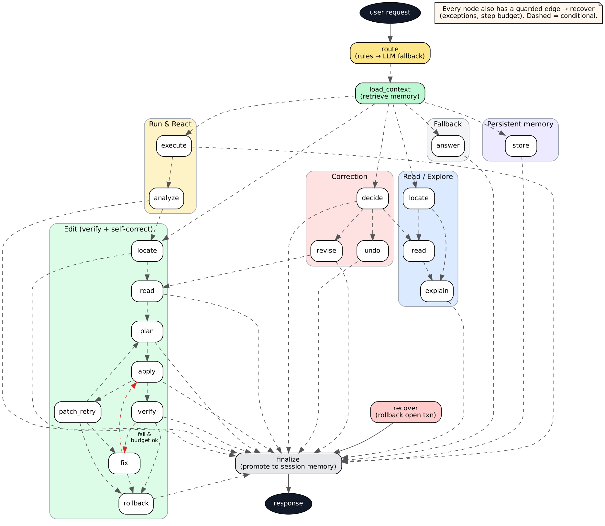

# Coding Agent: Design Writeup

**Stack:** LangGraph `StateGraph` orchestrator · two stdio MCP servers (filesystem, shell) behind a capability-mapped tool registry · three memory tiers · lint/test/policy feedback with bounded self-correction · transactional edits with rollback · JSONL tracing streamed live to the CLI.

## 1. State graph

The diagram is generated from the compiled graph (`make graph`), so it can't drift from the code.

- **Core spine:** `route → load_context → <trajectory entry> … → finalize`.
- **`route`** is a hybrid. Each trajectory contributes weighted regexes. A clear winner (score ≥ 1.0 and a margin of ≥ 0.5 over the runner-up) is routed with zero model calls. Otherwise the LLM picks from the registry's descriptions and examples, with the last three turns as context. Its answer is then validated: an unknown trajectory falls back to `chat`, and a model outage falls back to the best rule guess. The sample interaction from the brief routes entirely by rules. The demo's ambiguous "…return a 404 instead" goes to the model, because "instead" also looks like a correction.
- **Trajectories:**
  - **Explore:** `locate → read → explain`.
  - **Edit:** `locate → read → plan → apply → verify → (fix ↺ apply | rollback) → finalize`, plus `patch_retry` when a search/replace block doesn't apply.
  - **Run:** `execute → analyze → (finalize | hand off to edit_locate)`.
  - **Correct:** `decide → undo | revise → edit_read`.
  - **Remember:** `store`.
  - **Chat:** fallback.
- **Failure mid-flow:** `GraphBuilder` wraps every node in a trace span. It converts any exception into `state.error`, and every edge checks that first and diverts to **`recover`**. `recover` rolls back any open edit transaction, consulting the journal rather than graph state, because a node that raised mid-write never returned its transaction id; a fault-injection test caught exactly this bug. It then explains what happened and leaves the session usable. Two backstops stop runaway loops: a per-request step budget, and LangGraph's `recursion_limit`.
- **Adding a trajectory** means one module that calls `register(Trajectory(name, description, examples, patterns, entry, build))`. The router, graph and `/help` pick it up automatically, with no core edits.

## 2. Edit flow: "add input validation to the create task endpoint"

Actual trace from `demos/recordings/session1.txt`:

| Step | Calls | Why |
|---|---|---|
| route / load_context | 0 | Rule match on the "Add" verb; preferences, relevant lessons and a budgeted session context are retrieved |
| locate | `fs.list_directory` (cached) → `fs.search_code` ×1 | One regex search for all keywords. Files are scored by IDF-weighted hits (rare terms beat "task"), with 3× weight for definition lines |
| read | `fs.stat_files` ×1 → `fs.read_file` only for files that are new or changed | One batched hash check validates the session file cache. `routes/tasks.py` was a cache hit because it was read in the previous turn |
| plan | 1 LLM call | Search/replace JSON, validated against a schema with one automatic repair attempt |
| apply | `fs.tree_fingerprint`, `fs.write_file` ×2 (with `expected_sha256`) | A journal transaction opens. Writes refuse to clobber a file that changed since it was read |
| verify | `shell.run_command` (ruff `--fix`), `fs.stat_files`, `fs.tree_fingerprint`, `shell.run_command` (pytest) | Lint auto-fix, then the AST policy checks (no tool calls), then tests |
| baseline (only when tests fail *and* no baseline is in memory) | 2 writes, pytest, 2 writes | Swaps the original files back to learn which failures already existed |

That comes to 11 tool calls plus 1 LLM call in steady state, and 16 the first time, when it has to measure the baseline. In the demo the pagination test already fails, so the agent reports it as **pre-existing**. It does not "fix" it (scope creep) or roll back a correct edit.

## 3. An edit breaks the tests

`verify` sorts failing tests into three groups:

- **Regressions:** fail now, passed in the baseline.
- **Still-failing targets:** when the goal is "fix the failing test", the target tests are taken from session memory.
- **Pre-existing failures:** reported, not acted on.

Regressions, unfixed lint findings and policy violations go to `edit_fix` along with the current diff and the trimmed pytest output. The fix's writes join the **same transaction**, so a single undo reverts everything the request did. Three independent brakes stop the loop:

1. an attempt budget (`max_fix_attempts`, default 3)
2. no-progress detection: an identical failure signature, with line numbers normalised out
3. a "made it worse" check: the problem count grew

When any brake fires, the agent **rolls back to the exact pre-request bytes**, explains what's unresolved, and records a session note so the next attempt sees it. Session 3 shows this end to end: a rename breaks 4 tests, the fix attempt makes no progress, the edit rolls back, and the user's clarified request then succeeds.

**Correcting a "wrong but green" edit.** "That's wrong — …" reverts the last transaction and re-plans on the same files with the original goal, the feedback, and the rejected diff ("don't repeat this"). It also stores the feedback as a persistent **lesson**. "Undo" restores the files directly, using optimistic concurrency: if the user edited a file after the agent did, that file is reported as a conflict and left untouched.

## 4. Memory: what to keep vs discard

| Tier | Holds | Lifetime / eviction |
|---|---|---|
| Working | graph state: goal, targets, plan, transaction id, attempts, failure signatures | discarded after each request; `finalize` promotes a one-line outcome |
| Session | turns, files read (content + hash), commands with *parsed* failures, user feedback notes | file contents are an LRU (8 files) that keeps only a summary line when evicted; contents whose on-disk hash changed are dropped and never served stale; turns beyond 6 fold into an extractive rolling summary, itself capped in size |
| Persistent | preferences (explicit, high trust, optionally enforceable) and lessons (learned from corrections, retrieved only when relevant, max 50, least-useful evicted) | JSON with atomic writes; a corrupt file is quarantined, never crashes the agent |

**Retrieval** never dumps everything. `build_context` scores every item by keyword relevance to the request, exponential recency decay, and pins (files mentioned or currently in play), then packs the best into a token budget (default 1200). Old summarised turns compete under a low base score, so they surface only when relevant. Preferences are filtered by trajectory scope.

**When context fills,** the order of loss is: raw command output first (parsed into structured failures immediately), then cached file contents (re-read on demand, guarded by hash), then old turns (summarised). What survives longest is the parsed and decided material: test failures, edits made, user feedback, and preferences.

**Preferences are enforced, not just prompted.** "Always add docstrings" maps to an AST policy check that runs inside `verify`. In session 2 a violation forced a self-correction before the user ever saw the result. This makes preferences testable and model-independent.

## 5. Adding 10 more tools without touching core logic

1. Write or point to another MCP server and add it under `mcp_servers:` in `agent.yaml`. Tools are discovered at start-up via `list_tools` and namespaced `server.tool`.
2. Nodes ask for **capabilities** (`read_file`, `run_command`), not tool names. The `capabilities:` map binds them, so swapping in `@modelcontextprotocol/server-filesystem` is a config change.
3. The registry gives every tool the same handling:
   - JSON-schema argument validation before the call
   - a uniform `ToolResult` (validation, tool, transport and unknown-tool errors are never raised into nodes)
   - read-only caching driven by MCP's `readOnlyHint`, cleared by any side-effecting call
   - tracing
4. New behaviour that *uses* new tools (say, a `git` or `typecheck` trajectory) is one `register(...)` module. New feedback signals are a parser or a `POLICIES` entry.

The selection philosophy is that **deterministic code chooses the mechanical tool calls** (locate, read, verify). The LLM is spent on the judgement calls: routing when the rules are unsure, planning, fixing and explaining. That is why the sample interaction needs only one LLM call per edit and none for run or remember.

## Trade-offs & next steps

- Search/replace edits fail loudly (the error is fed back to the planner, bounded) instead of silently corrupting files; whole-file rewrites would be more robust for large refactors, at a higher token cost.
- Lexical retrieval keeps memory dependency-free and explainable. Embeddings would help on larger codebases.
- The shell allow-list is a guardrail, not a sandbox: `python` can run anything. Production should run the agent in a container.
- Next steps: LangGraph checkpointer for resumable sessions, human-in-the-loop `interrupt()` before large or multi-file edits, and per-hunk partial undo.
